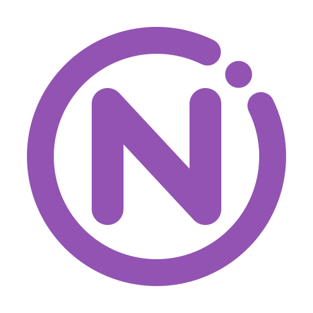

  <picture>
    <source media="(prefers-color-scheme: dark)" srcset="assets/branding/nebularix-mark-dark.svg">
    
  </picture>

# Nebularix

**Nebularix is a desktop app for batch photo export.**

It helps photographers, retouchers, designers, and content creators turn one set of finished images into ready-to-use versions for social media, client delivery, websites, print, and archives.

Add your photos, choose an Export Pack, pick an output folder, and Nebularix creates the variants for you.

> This public repository is used for release notes, the changelog, issues, and community discussions. Installers are hosted on dl.orbitalwhale.com — see [Download](#download). The application is developed privately by OrbitalWhale.

## Download

Download the latest version directly:

| System | Download |
|--------|----------|
| macOS | [Nebularix_latest_universal.dmg](https://dl.orbitalwhale.com/nebularix/latest/Nebularix_latest_universal.dmg) — one disk image for Apple Silicon and Intel Macs, macOS 10.15 or later |
| Windows | [Nebularix_latest_x64-setup.exe](https://dl.orbitalwhale.com/nebularix/latest/Nebularix_latest_x64-setup.exe) — 64-bit installer |
| Linux | [AppImage](https://dl.orbitalwhale.com/nebularix/latest/Nebularix_latest_amd64.AppImage) — any distribution with glibc 2.39 or later (e.g. Ubuntu 24.04+, Fedora 40+), HEIC support built in |
| | [.deb](https://dl.orbitalwhale.com/nebularix/latest/Nebularix_latest_amd64.deb) — Ubuntu 24.04+ / Debian 13+ |
| | [.rpm](https://dl.orbitalwhale.com/nebularix/latest/Nebularix-latest-1.x86_64.rpm) — Fedora / EPEL 10. Opening HEIC photos needs an HEVC decoder Fedora doesn't ship: install `libheif-freeworld` from RPM Fusion, or use the AppImage |

The macOS disk image is signed and notarized by Apple, and the Windows installer is code-signed.

Release notes for every version, with links to that version's installers, are on the [Releases](https://github.com/OrbitalWhaleLabs/nebularix/releases) page. Installers are hosted on dl.orbitalwhale.com, not attached to GitHub releases.

## What Nebularix Does

Nebularix is built around **Export Packs**: reusable export presets that create several output files from each source image.

For example, one edited photo can become:

- an Instagram square post
- an Instagram portrait post
- a story or reel cover
- a web portfolio image
- a small preview for a client
- a print-ready JPEG
- an archive copy with metadata preserved

Instead of exporting each version by hand, you choose the pack once and let Nebularix process the batch.

## Who It Is For

Nebularix is useful when you regularly prepare the same photos for several destinations:

- photographers delivering galleries to clients
- content creators publishing to multiple platforms
- studios preparing previews, finals, and archive copies
- designers exporting image sets for websites
- anyone tired of repeating the same resize, format, and naming steps

## Key Features

- **Batch export** — process many photos at once.
- **Export Packs** — ready-made presets for common workflows.
- **Multiple variants per photo** — one source image can produce several outputs.
- **Wide input format support** — JPEG, PNG, TIFF, WebP, AVIF, and HEIF source images.
- **JPEG, PNG, WebP, and AVIF output** — choose the right format for each destination.
- **Social media sizes** — Instagram, Facebook, X/Twitter, LinkedIn, Pinterest, and more.
- **Client delivery presets** — full-size, web-size, and preview exports.
- **Web portfolio exports** — responsive image sizes for websites.
- **Print-ready exports** — high quality JPEG output for print workflows.
- **Archive exports** — preserve originals, metadata, and color information where possible.
- **Metadata control** — preserve metadata, remove everything, strip GPS, or keep copyright data.
- **Color profile handling** — preserve profiles or convert to sRGB for web use.
- **Watermarks** — image or text watermarks with position, opacity, and shadow settings.
- **Watch folders** — automatically process new images dropped into selected folders.
- **Queue controls** — pause, resume, cancel, retry, and track progress.
- **Desktop app** — runs locally on your computer.
- **12-language interface** — English, Russian, Ukrainian, Simplified Chinese, Spanish, Japanese, German, French, Brazilian Portuguese, Korean, Turkish, and Polish.

## Built-In Export Packs

| Pack | What it is for |
|------|----------------|
| Instagram Complete | Feed square, feed portrait, feed landscape, story/reel formats |
| Web Portfolio | Hero, gallery, thumbnail, and social sharing images |
| Client Delivery | Full resolution, web-size, and preview files |
| Social Media Multi-Platform | Common sizes for Instagram, Facebook, X/Twitter, LinkedIn, and Pinterest |
| Print Ready | High-quality files for common print sizes |
| Archive & Backup | Long-term copies with metadata preservation |

> **Note on TIFF and HEIF sources:** Nebularix reads TIFF and HEIF/HEIC files, but does not yet write TIFF as an output format. In the **Archive & Backup** pack, TIFF and HEIF inputs are saved as PNG to avoid an additional JPEG compression step. Other transformations the pack performs (8-bit RGBA conversion, `LongEdge ≤ 8000px` resize, ICC handling per color policy) still apply. Native TIFF output with full bit-depth and metadata preservation (EXIF, ICC, XMP) is planned for v1.2.

## Demo And Full Version

Nebularix can run in demo mode so you can test the workflow before unlocking the full version.

Demo mode:

- processes up to 30 files per batch
- keeps exported images clean, without adding a trial watermark
- limits full-version features such as automated watch folders and custom watermarks

The full version is a **one-time purchase** — no subscription, no account required.

- **Perpetual license for Nebularix 1** — it never expires, and every 1.x update is included for as long as version 1 is maintained. A future Nebularix 2 would be a separate product.
- **Activated offline** — your license key is tied to the email address you bought it with and is verified on your machine. There is no activation server and no online check.

A 30-day money-back guarantee is offered through our payment processor.

## Privacy

Nebularix is a local desktop application. Photo processing happens entirely on your machine — your images are never uploaded to a cloud service.

- **No telemetry** — Nebularix does not send usage data or analytics about your work.
- **No account required** — you do not need to sign in to use the app.
- **Offline by design** — Nebularix works without an internet connection. License verification runs entirely on your machine; there is no activation server.
- **Optional update check** — if you turn it on, Nebularix downloads a small signed version file from dl.orbitalwhale.com and compares versions locally. Nothing about you, your photos, or your installed version is sent.

## Support And Feedback

Use this repository to report problems, request improvements, and follow releases:

- [Report a bug](https://github.com/OrbitalWhaleLabs/nebularix/issues)
- [Request a feature](https://github.com/OrbitalWhaleLabs/nebularix/issues)
- [Join discussions](https://github.com/OrbitalWhaleLabs/nebularix/discussions)
- [Read releases](https://github.com/OrbitalWhaleLabs/nebularix/releases)

For release history, see the changelog and the notes attached to each GitHub Release.

When reporting a bug, it helps to include:

- your operating system and version
- the Nebularix version
- what you were trying to export
- the selected Export Pack
- what happened instead of what you expected

Please do not upload private client photos unless you are comfortable making them public.

## Public Repository Scope

This repository is intentionally not a source-code repository.

It is used for:

- release notes and the changelog (with links to the installers on dl.orbitalwhale.com)
- bug reports
- feature requests
- community discussions

It is not used for source-code pull requests. The application itself is developed privately by OrbitalWhale.

## About

Nebularix is made by **OrbitalWhale**.

Website: [orbitalwhale.com](https://orbitalwhale.com)

Copyright (c) 2026 OrbitalWhale. All rights reserved.
